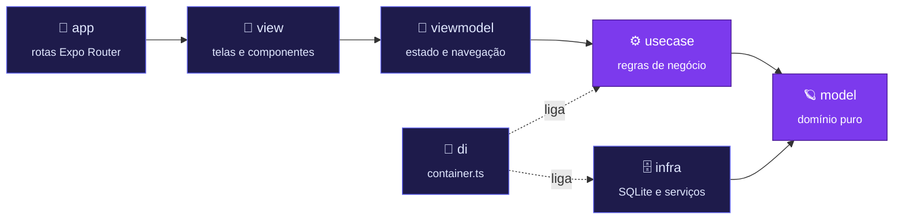
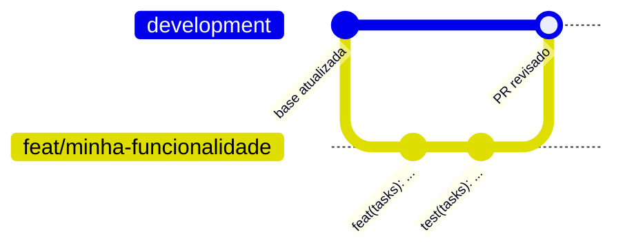

<div align="center">


### Organize seus estudos. Construa sua constância. Acompanhe sua órbita.

Aplicativo Android de organização pessoal e hábitos de estudo para estudantes,<br>
com tarefas, rotinas, Modo Foco e uma gamificação cósmica que valoriza o progresso, nunca pune.

<br>

[](https://reactnative.dev/)
[](https://expo.dev/)
[](https://www.typescriptlang.org/)
[](#-build-e-distribuição-android)

[](https://github.com/orbita83/Orbity/actions/workflows/ci.yml)
[](./CONTRIBUTING.md#4-processo-de-publicação-e-governança-de-releases)
[](./LICENSE)
[](./docs/storybook.md)
[](./docs/06-quality/guia-testes.md)

[**Sobre**](#-sobre-o-orbity) ·
[**Funcionalidades**](#-funcionalidades) ·
[**Começando**](#-começando) ·
[**Arquitetura**](#%EF%B8%8F-arquitetura) ·
[**Design System**](#-orbity-design-system-ods) ·
[**Contribuindo**](#-contribuindo) ·
[**Documentação**](#-mapa-da-documentação)

</div>

---

## 🪐 Sobre o Orbity

O **Orbity** reúne, em um só lugar, tudo o que o estudante precisa para organizar o dia a dia acadêmico: **tarefas**, **rotinas** e **sessões de foco**. Cada dia de constância alimenta uma **sequência** representada por um planeta em órbita, e cada marco vira uma **estrela** no seu Cosmos pessoal.

A proposta nasce de uma convicção simples: **organização deve acolher, não cobrar**. Por isso o Orbity:

| | Princípio | Na prática |
| :---: | :--- | :--- |
| 🎯 | **Foco e clareza cognitiva** | Uma tela inicial com o essencial: sua sequência, o progresso do dia e o atalho para o Modo Foco. |
| 🌌 | **Acolhimento visual** | Identidade cósmica em roxo e azul, com fundo espacial escuro aplicado a todas as telas. |
| 🧭 | **Autonomia do estudante** | Você define categorias, dias da rotina e o próprio ritmo. O app sugere, nunca impõe. |
| ♿ | **Acessibilidade nativa** | Contraste mínimo de 4,5:1, alvos de toque de 48 × 48 dp, leitores de tela e respeito à redução de movimento. |
| 💜 | **Zero mecânicas punitivas** | Nada de mensagens de culpa ou perda de progresso como castigo. A trajetória é sempre valorizada. |

> [!NOTE]
> O Orbity é desenvolvido por estudantes nas disciplinas de **Interação Humano-Computador (IHC)** e **Programação para Dispositivos Móveis (PDM)**. A plataforma principal é o **Android**, com distribuição prevista pela **Google Play Store**.

---

## ✨ Funcionalidades

<table>
<tr>
<td width="50%" valign="top">

#### 🏠 Tela Início
Planeta da sequência em órbita, progresso do dia e painel arrastável do **Modo Foco**, que fica bloqueado com uma orientação enquanto não houver tarefa ou rotina para vincular.

#### ✅ Tarefas
Filtros *Todos / Pendentes / Concluídas*, criação com data, hora e categoria, **seleção múltipla** para fixar ou excluir em lote e confirmação antes de ações destrutivas.

#### 🔁 Rotinas
Rotinas com ícone, dias da semana e tarefas próprias. Detalhe com progresso do dia, conclusão item a item e **Desfazer** após excluir.

</td>
<td width="50%" valign="top">

#### 🔥 Sequência (streak)
Calculada a partir do registro diário em SQLite: concluir tarefas ou rotinas mantém o planeta girando.

#### 👤 Perfil
Cabeçalho do estudante com nome editável, cards de métricas e atalhos para Conquistas, Categorias e Ajustes.

#### 🌠 Em construção
**Cosmos** (constelação de estrelas de sequência e conquistas), **Conquistas**, **Categorias** e **Configurações** já têm rota e estão especificados no Design System.

</td>
</tr>
</table>

| Módulo | Domínio e casos de uso | Persistência (SQLite) | Tela |
| :--- | :---: | :---: | :---: |
| Início (sequência, progresso e trava do Modo Foco) | ✅ | ✅ | ✅ |
| Sessão do Modo Foco (cronômetro) | 🗓️ | 🗓️ | 🚧 parcial |
| Tarefas | ✅ | ✅ | ✅ |
| Rotinas | ✅ | ✅ | ✅ |
| Sequência | ✅ | ✅ | ✅ |
| Perfil | ✅ | ✅ | ✅ |
| Cosmos, Conquistas, Categorias e Ajustes | 🗓️ | 🗓️ | 🚧 provisória |

<sub>✅ implementado · 🚧 tela provisória · 🗓️ planejado</sub>

---

## 🧰 Stack tecnológica

<div align="center">


</div>

| Camada | Tecnologia | Versão |
| :--- | :--- | :--- |
| **UI mobile** | React Native · React | `0.86.3` · `19.2.3` |
| **Plataforma e rotas** | Expo SDK · Expo Router | `~57.0.30` · `~57.0.28` |
| **Linguagem** | TypeScript (`"strict": true`) | `~6.0.3` |
| **Animações e gestos** | Reanimated · Gesture Handler · SVG | `4.5.1` · `~2.32.0` · `15.15.4` |
| **Persistência local** | `expo-sqlite` (Android) · `node:sqlite` (testes, embutido no Node.js) | `57.0.7` · Node.js 22.15+ |
| **Catálogo de componentes** | Storybook (`react-native-web-vite`) · Vite | `10.6.2` · `6.4.4` |
| **Testes** | Jest · `jest-expo` · Testing Library | `~29.7.0` · `~57.0.6` · `^14.1.0` |
| **Qualidade** | ESLint · Husky · lint-staged · Commitlint | `^9` · `^9.1.7` · `^16.4.0` · `^21.2.3` |
| **Build e distribuição** | EAS CLI (fixado em `devDependencies`) | `27.5.0` |

---

## 🚀 Começando

### Pré-requisitos

| Ferramenta | Versão | Observação |
| :--- | :--- | :--- |
| **Node.js** | 22 LTS (22.15+) | Mesma versão do runner do [CI](./.github/workflows/ci.yml). Os testes usam o `node:sqlite`, embutido no Node.js. |
| **npm** | 10+ | Distribuído com o Node.js 22. |
| **Git** | 2.38+ | Com suporte a `git switch`. |
| **Android** *(opcional)* | — | Aparelho com **Expo Go** (SDK 57) ou *development build*, **ou** emulador do Android Studio com `adb`. |

> [!TIP]
> Nenhuma variável de ambiente, chave ou conta externa é necessária para clonar, rodar o app em desenvolvimento, abrir o Storybook ou executar os testes.

### Instalação

```bash
# 1. Clone o repositório
git clone https://github.com/orbita83/Orbity.git
cd Orbity

# 2. Parta da development atualizada
git switch development
git pull --ff-only origin development

# 3. Instale as dependências (também ativa os hooks do Husky)
npm ci
```

### Executando

```bash
npm start          # Servidor de desenvolvimento do Expo (Metro)
npm run android    # Abre no emulador ou no aparelho conectado via adb
npm run storybook  # Catálogo de componentes em http://localhost:6006
```

<details>
<summary><b>📜 Todos os scripts do <code>package.json</code></b></summary>

<br>

| Script | Comando | Finalidade |
| :--- | :--- | :--- |
| `npm start` | `expo start` | Servidor de desenvolvimento (Metro Bundler). |
| `npm run android` | `expo start --android` | Abre no emulador Android ou no aparelho via `adb`. |
| `npm run ios` | `expo start --ios` | Simulador iOS (macOS + Xcode). Fora do foco atual. |
| `npm run lint` | `expo lint` | Verificação estática com ESLint. |
| `npm run lint:architecture` | `node scripts/lint-architecture.mjs` | Verifica os limites entre as camadas da arquitetura. |
| `npm run typecheck` | `expo customize tsconfig.json && tsc --noEmit` | Regenera rotas tipadas do Expo Router e verifica tipos TypeScript. |
| `npm test` | `jest --watchAll=false` | Suíte completa, não interativa. |
| `npm run test:watch` | `jest --watch` | Jest em modo interativo. |
| `npm run storybook` | `storybook dev -p 6006` | Storybook na porta 6006. |
| `npm run build-storybook` | `storybook build` | Build estático em `storybook-static/`. |

</details>

---

## 🏛️ Arquitetura

O Orbity segue o **MVVM Sofisticado com Clean Architecture**, com **Inversão de Dependências (DIP)** e um único **Composition Root**. Os detalhes estão em [`ARCHITECTURE.md`](./ARCHITECTURE.md) e as convenções em [`RULES.md`](./RULES.md).



```text
src/
├── app/         # Rotas do Expo Router (kebab-case.tsx) que reexportam as telas da view
├── view/        # Telas, componentes reutilizáveis (components/, PascalCase) e tema (theme/)
├── viewmodel/   # Hooks use*ViewModel.ts: estado, ações e navegação
├── usecase/     # Contratos (i*UseCases.ts) e implementações das regras de negócio
├── model/       # Domínio puro: entities/, errors.ts, datasources/ e services/
├── infra/       # Implementações concretas (SQLite, datasources) com tradução para DomainError
└── di/          # Composition Root: único ponto que conecta infra e usecase
```

<details>
<summary><b>🔎 Regras que sustentam a arquitetura</b></summary>

<br>

- **Navegação na ViewModel:** a View não chama hooks de navegação; quem usa o `router` do `expo-router` é a ViewModel.
- **Erros tipados:** a Infra converte falhas técnicas em subclasses de `DomainError`; só a ViewModel usa `try/catch` e decide com `instanceof`. A View apenas lê `error` e `loading`.
- **Persistência isolada:** só `src/infra/database/expoSqlExecutor.ts` importa o `expo-sqlite` ([ADR-0001](./docs/05-architecture/decisions/ADR-0001.md)). Os testes usam um executor sobre o `node:sqlite`, embutido no Node.js.
- **Testabilidade em três níveis:** as ViewModels recebem um `I*UseCases` opcional, o que permite substituir dependências no Use Case, no container ou na ViewModel.
- **Alias:** `@/*` aponta para `src/*` e `@/assets/*` para `assets/*`.

</details>

---

## 🎨 Orbity Design System (ODS)

O **ODS** adapta o **Material Design 3** à identidade cósmica do Orbity e define princípios, tokens, fundamentos, componentes, padrões e critérios de acessibilidade. Os componentes consomem apenas os tokens de [`src/view/theme/tokens.ts`](./src/view/theme/tokens.ts), espelho de [`02-tokens.md`](./design-system/02-tokens.md). Valores literais de cor, espaçamento, tipografia ou raio não são permitidos.

<div align="center">

|  |  |  |  |  |  |
| :---: | :---: | :---: | :---: | :---: | :---: |
| `purple-500` | `purple-400` | `purple-200` | `blue-600` | `neutral-900` | `success-500` |

</div>

> [!NOTE]
> **Tema:** o app usa a identidade 🌌 **cósmica** (`themes.cosmic`) em todas as telas.

| Documento | Conteúdo |
| :--- | :--- |
| [`01-principios.md`](./design-system/01-principios.md) | Valores de produto e interface. |
| [`02-tokens.md`](./design-system/02-tokens.md) | Tokens primitivos, semânticos e de componente. |
| [`03-fundamentos.md`](./design-system/03-fundamentos.md) | Cor, tipografia, espaçamento, ícones, elevação e movimento. |
| [`04-componentes/`](./design-system/04-componentes/) | Especificação de cada componente. |
| [`05-padroes.md`](./design-system/05-padroes.md) | Fluxos de interação e composição de telas. |
| [`06-acessibilidade.md`](./design-system/06-acessibilidade.md) | Contraste, alvos de toque, foco, leitores de tela e redução de movimento. |

> [!IMPORTANT]
> Ao alterar `src/view/theme/tokens.ts`, rode `node tests/ods-theme.test.cjs`. Ele valida os valores dos temas e as razões de contraste, e **não** é coletado pelo Jest.

---

## 🧪 Qualidade e testes

O CI ([`ci.yml`](./.github/workflows/ci.yml)) roda em todo Pull Request para `development`. Execute o mesmo checklist localmente antes de commitar:

```bash
npm run lint                     # 1. ESLint
npm run lint:architecture        # 2. Limites entre as camadas da arquitetura
npm run typecheck                # 3. Rotas tipadas do Expo Router + tipos TypeScript (modo estrito)
npm run build-storybook          # 4. Build do Storybook (uma story quebrada falha o CI)
npm test                         # 5. Jest + Testing Library
node tests/ods-theme.test.cjs    # 6. Contratos de tema e contraste do ODS
node scripts/verify-local-hooks.mjs  # Ao alterar .husky/, scripts/ ou commitlint.config.cjs
```

| Hook do Husky | O que executa |
| :--- | :--- |
| `pre-commit` | ESLint nos arquivos preparados e, se o commit incluir arquivos de `src/`, o linter de arquitetura (lint-staged, em `lint-staged.config.mjs`). |
| `commit-msg` | Commitlint no formato do projeto. |
| `pre-push` | `scripts/validate-branch.mjs` (nome da branch). |

> [!TIP]
> Em máquinas lentas, testes de tela podem estourar o tempo limite na suíte completa. Rode o arquivo isolado (`npx jest caminho/do/arquivo.test.tsx`) ou use `npx jest --maxWorkers=2` antes de concluir que há defeito.

O guia completo, com organização por camada, *test doubles* e *fixtures*, está em [`docs/06-quality/guia-testes.md`](./docs/06-quality/guia-testes.md).

---

## 📦 Build e distribuição Android

Os builds usam o **EAS** com o CLI fixado no projeto. Identificador do app: `io.github.orbita83.orbity`.

| Perfil | Artefato | Uso |
| :--- | :--- | :--- |
| `development` | `.apk` com `expo-dev-client` | Depuração e testes internos. |
| `preview` | `.apk` de distribuição interna | Validação em aparelhos sem servidor de desenvolvimento. |
| `production` | `.aab` (Android App Bundle) | Submissão à Google Play Store. |

> [!WARNING]
> Builds na nuvem, credenciais de assinatura e publicação na Google Play são restritos às contas autorizadas. O keystore fica no EAS (`credentialsSource: remote`) e **nunca** é versionado. Para inspecionar a configuração sem login, use `npx --no-install expo config --type public`.

Guias: [EAS Build](./docs/08-distribution/eas-build.md) · [Assinatura](./docs/08-distribution/assinatura-e-builds-android.md) · [Build sob demanda](./docs/08-distribution/build-sob-demanda.md) · [Google Play](./docs/08-distribution/submissao-google-play.md) · [Versionamento](./docs/08-distribution/versionamento-do-app.md)

---

## 🤝 Contribuindo

Todo o fluxo está formalizado no [`CONTRIBUTING.md`](./CONTRIBUTING.md). Em resumo:



| Convenção | Formato | Exemplo |
| :--- | :--- | :--- |
| **Branch** | `<prefixo>/<descricao-curta>` | `feat/filtro-tarefas` |
| **Commit** | `<prefixo>(<escopo>): <descrição em pt-br>` | `feat(tasks): adiciona filtro por prioridade` |
| **Prefixos** | `feat` · `fix` · `docs` · `refactor` · `test` · `chore` | — |
| **Pull Request** | Para `development`, com o [template de desenvolvimento](./.github/PULL_REQUEST_TEMPLATE/development.md) | — |
| **Release** | `development → main`, com o [template de release](./.github/PULL_REQUEST_TEMPLATE/release.md) e tag anotada | `v0.1.0` |

- 🚫 Nunca altere `main` ou `development` diretamente.
- 🚫 Nunca use `--no-verify` nem `HUSKY=0` para contornar os hooks.
- 🌎 **Idioma:** `pt-BR` na interface, na documentação, nos commits, nas issues e nos PRs; inglês nos identificadores de código em `src/`.

---

## 📚 Mapa da documentação

| Área | Onde encontrar |
| :--- | :--- |
| 🧭 **Contribuição e governança** | [`CONTRIBUTING.md`](./CONTRIBUTING.md) |
| 🏛️ **Arquitetura** | [`ARCHITECTURE.md`](./ARCHITECTURE.md) · [ADRs](./docs/05-architecture/decisions/) |
| 📏 **Convenções de código** | [`RULES.md`](./RULES.md) |
| 🤖 **Agentes de IA** | [`AGENTS.md`](./AGENTS.md) · [`CLAUDE.md`](./CLAUDE.md) |
| 🎨 **Design System** | [`design-system/`](./design-system/README.md) |
| 📋 **Requisitos** | [Funcionais](./docs/02-requirements/functional/) · [Não funcionais](./docs/02-requirements/non-functional/) · [Regras de negócio](./docs/02-requirements/business-rules/) |
| 🗂️ **Backlog** | [Épicos e histórias](./docs/03-backlog/) |
| 🔀 **Especificações** | [Casos de uso](./docs/04-specifications/use-cases/) · [Fluxos](./docs/04-specifications/flows/) · [Casos de borda](./docs/04-specifications/edge-cases/) |
| 📐 **Designs técnicos** | [`docs/designs/`](./docs/designs/README.md) |
| 🧪 **Qualidade** | [Guia de testes](./docs/06-quality/guia-testes.md) |
| 📖 **Storybook** | [`docs/storybook.md`](./docs/storybook.md) |
| 📦 **Distribuição** | [`docs/08-distribution/`](./docs/08-distribution/README.md) |

---

## 👩‍🚀 Equipe

<div align="center">

<table>
<tr>
<td align="center"><a href="https://github.com/MailsonSousa88"><br><sub><b>Mailson Sousa</b></sub></a></td>
<td align="center"><a href="https://github.com/Cassiosampaio2016"><br><sub><b>Cássio Sampaio</b></sub></a></td>
<td align="center"><a href="https://github.com/MateusARJ"><br><sub><b>Mateus de Araujo</b></sub></a></td>
<td align="center"><a href="https://github.com/vitorlopes-coder"><br><sub><b>Vitor Lopes</b></sub></a></td>
<td align="center"><a href="https://github.com/AlissonSena7"><br><sub><b>Alisson Ramires</b></sub></a></td>
</tr>
</table>

</div>

---

<div align="center">

Distribuído sob a licença **MIT**. Veja [`LICENSE`](./LICENSE) para mais detalhes.

<sub>Feito com 💜 por estudantes, para estudantes. Cada dia conta, e nenhum dia apaga o caminho percorrido. 🪐</sub>

</div>
