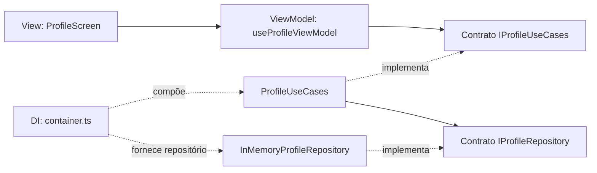

# Implementação da tela Meu Perfil

> Levantamento técnico em **15/11/2026**, na branch local `feat/perfil-metricas-atalhos`, com HEAD `7e88f63` e as alterações locais existentes, incluindo arquivos ainda não rastreados. Este documento descreve o diretório de trabalho; não representa uma versão publicada ou um PR integrado.

A [spec técnica da #124](04-specifications/issue-0124-perfil-metricas-atalhos.md) foi sincronizada com esta explicação e com o código horizontal em 15/11/2026. Os marcos de testes anteriores são preservados como histórico; a contagem mais recente registrada é 89 testes em 16 suítes, sem nova execução integral na sincronização documental.

Referências: [Issue principal #120](https://github.com/orbita83/Orbity/issues/120), [identificação e edição #123](https://github.com/orbita83/Orbity/issues/123), [métricas e atalhos #124](https://github.com/orbita83/Orbity/issues/124), [ARCHITECTURE.md](../ARCHITECTURE.md), [RULES.md](../RULES.md), [AGENTS.md](../AGENTS.md) e [CONTRIBUTING.md](../CONTRIBUTING.md).

## 1. Introdução

A tela **Meu perfil** reúne a identificação do estudante, a edição do nome, indicadores de estudo e acessos a outras áreas do aplicativo. Permite consultar a trajetória do estudante com linguagem acolhedora, sem penalizar a interrupção de uma sequência.

Sua referência funcional é o [UC-0014 — Consultar perfil](04-specifications/use-cases/UC-0014-consultar-perfil.md), associado ao [FL-0014](04-specifications/flows/FL-0014.md) e ao padrão [F10 do ODS](../design-system/05-padroes.md#8-perfil-f10).

| Issue | Contribuição para a tela |
| --- | --- |
| #123 | Cabeçalho, avatar por inicial, `ProfileHeaderCard`, `EditProfileNameModal`, validação e atualização do nome; entidade, contratos, repositório em memória, DI e ViewModel compartilhada. |
| #124 | `ProfileMetricsCard`, normalização de métricas, `ProfileShortcutItem`, destinos provisórios e preservação das cinco abas. Inclui os refinamentos posteriores de contorno, foco e disposição horizontal. |
| #120 | Coordenação da composição e da validação integrada das duas sub-issues. |

Na consulta ao GitHub feita para esta documentação, #123 está encerrada; #120 e #124 permanecem abertas. O encerramento de uma issue não comprova, isoladamente, todas as verificações manuais.

O estudante já pode consultar os dados em memória, editar o nome e abrir os três destinos. **Conquistas, Categorias e Configurações ainda são telas provisórias.** Não há persistência definitiva, autenticação, cálculo de indicadores a partir de sessões nem gerenciamento real dessas três áreas nesta entrega.

## 2. Visão geral da implementação

### 2.1. Tecnologias e organização

O [package.json](../package.json) declara React Native `0.86.3`, Expo `~57.0.30`, Expo Router `~57.0.28`, React `19.2.3` e TypeScript `~6.0.3`. A interface usa React Native, `react-native-safe-area-context` e ícones SVG. Os testes utilizam Jest, `jest-expo` e Testing Library; as histórias usam Storybook com `@storybook/react-native-web-vite`.

| Área | Arquivos centrais | Papel |
| --- | --- | --- |
| Rotas | `src/app/profile.tsx`, `achievements.tsx`, `categories.tsx`, `settings.tsx`, `_layout.tsx` | Expor telas e configurar destinos no Expo Router. |
| View | `src/view/ProfileScreen.tsx`, três telas provisórias e `src/view/components/` | Compor a interface e apresentar estado. |
| Tema | `src/view/theme/tokens.ts` | Resolver tokens e temas compartilhados. |
| ViewModel | `src/viewmodel/ProfileViewModel.ts` | Manter estado e ações de apresentação. |
| Use Case | `src/usecase/profile-use-cases.ts` | Declarar `IProfileUseCases`, validar o nome e normalizar métricas. |
| Model | `src/model/entities/student-profile.ts`, `repositories/profile-repository.ts`, `errors/domain-error.ts`, `__fixtures__/student-profile.fixture.ts` | Entidade, contratos, erros e dados de referência puros. |
| Infra | `src/infra/repositories/in-memory-profile-repository.ts` | Armazenar e consultar o perfil em memória. |
| DI | `src/DI/container.ts` | Instanciar e conectar implementações concretas. |

O levantamento considerou também arquivos novos e modificados de testes, histórias, `jest.config.js`, `tests/ods-theme.test.cjs` e documentação de tokens. O ajuste no Jest permite transformar o pacote ESM `standard-navigation`, carregado pelo Expo Router; não instala uma dependência nova.

### 2.2. Relação entre componentes

```text
ProfileScreen
├── ConnectedProfileScreen → useProfileViewModel() [sem estado injetado]
└── ProfileContent
    ├── título "Meu perfil"
    ├── alerta global + PrimaryButton [quando error existe]
    ├── ProfileHeaderCard
    ├── ProfileMetricsCard
    ├── ProfileShortcutItem × 3
    └── EditProfileNameModal

AchievementsScreen / CategoriesScreen / SettingsScreen
└── ProfilePlaceholderScreen
    └── PlaceholderScreen
        └── PrimaryButton "Voltar ao perfil"
```

`ConnectedProfileScreen`, `ProfileContent` e `ProfileShortcutLink` são componentes privados de seus módulos. Não são novas rotas, entidades ou ViewModels.

## 3. Componentes e responsabilidades

### 3.1. ProfileScreen, ProfileContent e ConnectedProfileScreen

**Arquivo:** [src/view/ProfileScreen.tsx](../src/view/ProfileScreen.tsx).

`ProfileScreen` é exportada como `default`. Recebe `theme?` e `viewModel?`; esta última propriedade tem tipo `ProfileState & ProfileActions`, permitindo cenários controlados em testes e histórias.

Sem `viewModel`, monta `ConnectedProfileScreen`, que chama `useProfileViewModel()` e entrega o resultado a `ProfileContent`. Com uma ViewModel fornecida, renderiza diretamente `ProfileContent`: não monta um segundo hook nem dispara uma consulta de produção desnecessária.

`ProfileContent` usa `SafeAreaView` e `ScrollView`, resolve `themes.cosmic` por padrão e distribui o mesmo `profile` para identificação e métricas. O mesmo `loading` controla os skeletons do cabeçalho, do cartão e dos atalhos. Não existe uma consulta separada de métricas.

Quando há `error`, mostra uma mensagem com papel `alert` e região ativa `polite`, acompanhada do ícone `info`. O botão **Tentar novamente** dispara `clearError()` e `loadProfile()`. A View não captura exceções de negócio.

O modal recebe texto, visibilidade, `saving`, erro de validação e callbacks da ViewModel. A tela não valida nomes nem corrige números: sua responsabilidade é compor a apresentação e disparar ações.

### 3.2. ProfileHeaderCard

**Arquivo:** [src/view/components/ProfileHeaderCard.tsx](../src/view/components/ProfileHeaderCard.tsx).

É o cartão de identificação. Recebe `name?`, `loading?`, `onEditPress?` e `theme?`, com nome vazio, carregamento falso e tema cósmico como padrões.

O avatar não é uma foto: sua inicial vem de `name.trim().charAt(0).toUpperCase()`, com `"?"` como fallback. O componente mostra nome, subtítulo **Estudante** e botão de edição com ícone `edit`. O avatar é decorativo para o leitor de tela; o botão anuncia **Editar nome do perfil** e chama `onEditPress`.

Em carregamento, apresenta skeleton de avatar, nome e subtítulo com anúncio `busy`. Fora dele, mantém somente o estado visual local `isFocused` do botão. Não consulta dados nem salva o nome.

O nome visível usa `numberOfLines={2}`. Esse limite e os estilos herdados da primeira entrega precisam ser considerados na verificação de fonte ampliada; não se deve afirmar ausência total de truncamento em toda a tela.

### 3.3. EditProfileNameModal

**Arquivo:** [src/view/components/EditProfileNameModal.tsx](../src/view/components/EditProfileNameModal.tsx).

É o formulário modal de edição, controlado pela ViewModel.

| Propriedade | Uso |
| --- | --- |
| `visible` | Abrir ou ocultar o `Modal`. |
| `name` | Preencher o `TextInput` controlado. |
| `saving?` | Bloquear entrada e botões, mostrando "Salvando...". |
| `validationError?` | Exibir erro junto ao campo. |
| `onChangeName` | Comunicar a digitação. |
| `onSave` / `onClose` | Solicitar salvar ou fechar. |
| `theme?` | Resolver a apresentação; o padrão é cósmico. |

O modal usa `KeyboardAvoidingView`, título **Editar nome**, campo **Nome do estudante**, contador `name.length/60`, ações Salvar e Cancelar e botão de fechar. `maxLength={60}` limita a digitação; a regra definitiva continua no Use Case, inclusive para chamadas fora da interface.

O campo usa `autoFocus`, rótulo associado e `editable={!saving}`. Salvar anuncia `busy` e `disabled`. Erros de validação usam `alert` e região ativa `polite`. Os estados locais controlam somente o foco visual dos controles; o texto vem das propriedades.

O modal dispara `onSave`. Embora `saveName()` retorne `Promise<boolean>`, esse resultado não é consumido pelo modal: as mudanças reativas em `saving`, `validationError` e `isEditingName` atualizam a interface. Cancelar e fechar solicitam `onClose`, sem gravar dados.

O `Modal` usa `animationType="fade"` e encaminha `onRequestClose` diretamente a `onClose`. Os botões e o toque no fundo são bloqueados durante salvamento, mas não há uma condição `saving` nesse encaminhamento do retorno nativo. Não se deve afirmar que todos os caminhos de fechamento estão bloqueados.

### 3.4. ProfileMetricsCard

**Arquivo:** [src/view/components/ProfileMetricsCard.tsx](../src/view/components/ProfileMetricsCard.tsx).

É um componente de apresentação com exportação nomeada. Recebe `metrics`, contendo os três campos numéricos ou `null`; `loading`, obrigatório; e `theme?`. Espera valores já normalizados.

A lista local `entries` organiza rótulos e unidades. Os números são formatados com `toLocaleString("pt-BR")`. Cada grupo anuncia número e unidade no singular ou plural, por exemplo **1 dia de sequência** ou **5 conquistas adquiridas**.

A apresentação atual é **horizontal, com três colunas iguais**: dias, conquistas e horas. `metricsRow` usa `flexDirection: "row"`; cada `metric` usa `flex: 1`, `minWidth: 0` e alinhamento central. Dois divisores verticais ficam entre as colunas, usando `divider.width`, `color.border` e alongamento vertical, sem altura fixa.

Os textos permitem escala de fonte e não usam `numberOfLines`. A altura cresce com a quebra de linha. Os valores têm cápsulas com `on-action` sobre `action`; as legendas são centralizadas. A borda externa também existe no skeleton e garante separação do fundo sem depender da elevação Android.

O skeleton reproduz as três colunas e oculta as barras do leitor de tela. Com três zeros, a mensagem acolhedora aparece **abaixo da linha inteira**. `metrics === null`, fora de carregamento, informa indisponibilidade sem fabricar zeros. Consulta e recuperação não são responsabilidades do cartão.

### 3.5. ProfileShortcutItem e ProfileShortcutLink

**Arquivo:** [src/view/components/ProfileShortcutItem.tsx](../src/view/components/ProfileShortcutItem.tsx).

`ProfileShortcutItem` representa uma opção navegável. Recebe `icon`, `title`, `description`, `href`, `loading?` e `theme?`; o tipo de `href` restringe os destinos a `/achievements`, `/categories` e `/settings`.

Em carregamento, apresenta skeleton sem link e com estado `busy`. Caso contrário, monta o componente privado `ProfileShortcutLink`, que usa `Link asChild` envolvendo `Pressable`. A navegação é declarativa porque não exige uma operação de negócio antes do toque.

`ProfileShortcutLink` guarda o estado local `focused`. Foco e blur mudam a cor de um contorno externo com largura, afastamento e raio derivados dos tokens. Sua geometria é reservada mesmo sem foco, evitando deslocamento. `StyleSheet.flatten` entrega um objeto de estilo ao filho de `Link`, atendendo à necessidade do adaptador de Slot do Expo Router.

O callback de renderização do `Pressable` recebe `pressed`. Apenas o ícone inicial recebe `feedback.pressedOpacity`; texto e foco mantêm a opacidade. Ícone e chevron são decorativos. O controle fornece papel de link, título como nome acessível e descrição como dica.

Separar o controle privado elimina o foco residual: ao entrar em carregamento, ele é desmontado. Ao retornar, inicia sem foco visual antigo. Isso não força o foco do teclado para o atalho; o usuário pode focá-lo novamente.

### 3.6. PlaceholderScreen e ProfilePlaceholderScreen

**Arquivos:** [PlaceholderScreen.tsx](../src/view/components/PlaceholderScreen.tsx) e [ProfilePlaceholderScreen.tsx](../src/view/components/ProfilePlaceholderScreen.tsx).

`PlaceholderScreen` recebe `title`, `message`, `theme?` e `onReturn?`. Mostra título e mensagem em uma área rolável. Se houver `onReturn`, apresenta `PrimaryButton` com **Voltar ao perfil**. As propriedades opcionais preservam os usos anteriores do componente.

`ProfilePlaceholderScreen` especializa a apresentação para os destinos do perfil. Recebe `title` e `theme?`, usa `SafeAreaView` e fornece **Esta seção estará disponível em breve.**. Obtém o roteador por `useRouter()` e define `returnToProfile`, que executa `router.replace("/profile")`.

Também registra o retorno Android com `useFocusEffect` e `BackHandler`, apenas enquanto a tela está em foco, removendo a inscrição ao sair. Esses componentes não leem nem escrevem dados de domínio.

### 3.7. Telas provisórias

**Arquivos:** [AchievementsScreen.tsx](../src/view/AchievementsScreen.tsx), [CategoriesScreen.tsx](../src/view/CategoriesScreen.tsx) e [SettingsScreen.tsx](../src/view/SettingsScreen.tsx).

`AchievementsScreen`, `CategoriesScreen` e `SettingsScreen` são exportadas como `default`. Cada uma compõe `ProfilePlaceholderScreen` com o título correspondente. Não recebem dados de conquistas, categorias ou preferências, não possuem ViewModel própria e não simulam funcionalidades finais.

### 3.8. Componentes compartilhados de apoio

| Componente e arquivo | Dados e funcionamento relevantes |
| --- | --- |
| [PrimaryButton](../src/view/components/primary-button.tsx) | Recebe `label`, `onPress`, `accessibilityHint?`, `disabled?` e `theme?`. Implementa alvo mínimo e foco com tokens. É usado para tentar novamente e retornar. Seu padrão isolado é `themes.light`, mas o perfil fornece seu tema. |
| [MaterialSymbol](../src/view/components/material-symbol.tsx) | Recebe `name`, `color`, `size?` e `filled?`. Seleciona caminhos do catálogo, usando SVG no navegador e `react-native-svg` no nativo. É decorativo para o leitor. O perfil utiliza `edit`, `close`, `info`, `emoji_events`, `category`, `settings` e `chevron_right`. |
| [MainTabBar](../src/view/components/MainTabBar.tsx) | Recebe estado e navegação de `Tabs`, converte a rota ativa em `NavTabId`, reserva a área segura inferior e encaminha a seleção à `NavBar`. |
| [NavBar](../src/view/components/nav-bar.tsx) | Recebe `activeTab`, `onSelectTab`, `visible?`, `theme?` e `tabs?`. `DEFAULT_NAV_TABS` contém os cinco destinos principais. Apresenta rótulo, ícone, seleção e foco; não conhece os Use Cases de perfil. |

## 4. Métricas: significado, origem e estados

### 4.1. Significado e origem dos dados

| Campo | Rótulo | Limite da implementação |
| --- | --- | --- |
| `streakDays` | Dias de sequência | Quantidade fornecida pelo perfil. A tela não identifica dias consecutivos nem aplica regras de calendário. |
| `achievementsCount` | Conquistas adquiridas | Contagem fornecida pelo perfil. Não consulta nem desbloqueia conquistas. |
| `studyHours` | Horas de estudos completos | Quantidade de horas fornecida pelo perfil. Não soma sessões, converte minutos ou acompanha cronômetros. |

O repositório padrão é inicializado com `mockStudentProfile`: `id: "student-1"`, nome **Alex Silva**, sequência **12**, conquistas **5** e horas **42**. São dados de referência de [student-profile.fixture.ts](../src/model/__fixtures__/student-profile.fixture.ts), utilizados também pelo adapter atual, e não indicadores calculados do uso real do aplicativo.

### 4.2. Normalização

No [módulo de Use Cases](../src/usecase/profile-use-cases.ts), `normalizeMetric` é privada ao módulo:

```ts
const normalizeMetric = (value: unknown): number =>
  typeof value === "number" && Number.isFinite(value) && value > 0
    ? Math.trunc(value)
    : 0;
```

| Entrada | Saída | Motivo |
| --- | --- | --- |
| `12` | `12` | Inteiro positivo válido. |
| `12.9` | `12` | Descarte da parte fracionária. |
| `0.9` | `0` | Truncamento, sem arredondar para cima. |
| `0`, negativos ou `-0` | `0` | Métricas não negativas. |
| `NaN`, `Infinity`, `-Infinity` | `0` | Rejeição de números não finitos. |
| `"12"`, `null`, `undefined` ou outro tipo inválido em execução | `0` | Ausência de coerção para número. |

A regra também vale para horas: `42.8` torna-se `42`. O truncamento integral foi uma decisão aprovada para esta entrega, não uma definição do cálculo de sessões futuras.

`normalizeProfile` cria uma cópia, preserva `id` e `name` e corrige somente as três métricas. É aplicada no retorno de `getProfile()` **e de `updateName()`**, impedindo que salvar o nome reintroduza valores inválidos no estado da tela.

Consultar normaliza a resposta sem gravar essa correção no repositório. Um valor bruto fracionário pode continuar em memória e ser normalizado de novo na consulta seguinte. Uma falha de consulta não é convertida em perfil com zeros.

### 4.3. Estados e organização horizontal

| Condição | Métricas | Efeito no restante da tela |
| --- | --- | --- |
| `loading` verdadeiro | Skeleton horizontal com anúncio de carregamento. | Identificação e atalhos também mostram skeleton. |
| `loading` falso e perfil ausente | Indisponibilidade, sem números. | Se há `error`, aparece o alerta; atalhos ficam disponíveis. |
| Três métricas normalizadas iguais a zero | Três zeros e mensagem acolhedora abaixo das colunas. | Não existe punição visual. |
| Alguma métrica positiva | Indicadores apresentados normalmente. | Atalhos disponíveis. |
| Falha de recarga com perfil anterior | Há skeleton durante a consulta; em falha, os dados anteriores permanecem no estado e voltam a aparecer. | Alerta global oferece nova tentativa. |
| `saving` verdadeiro | Dados conhecidos continuam visíveis. | O modal mostra o salvamento; não é uma recarga de métricas. |

O vazio é derivado de `entries.every(({ value }) => value === 0)` na apresentação. Não há propriedade pública `isEmpty`, enum de status ou estado separado de métricas. Valores brutos inválidos que resultem em três zeros também aparecem como vazio: não existe indicador separado de qualidade dos dados.

## 5. Arquitetura MVVM Sofisticado

### 5.1. Dependências e percurso dos dados



As setas representam dependências. Em execução, o contrato resolve para `ProfileUseCases`, que chama o repositório fornecido pela DI. A resposta normalizada percorre o caminho inverso, atualiza o estado React e provoca a renderização. A View não chama a Infra diretamente.

### 5.2. Model

[StudentProfile](../src/model/entities/student-profile.ts) é uma interface pura com cinco propriedades `readonly`: `id`, `name`, `streakDays`, `achievementsCount` e `studyHours`. Não contém React, Expo ou armazenamento.

[IProfileRepository](../src/model/repositories/profile-repository.ts) define apenas:

```ts
getProfile(): Promise<StudentProfile>;
updateName(name: string): Promise<StudentProfile>;
```

[DomainError e ValidationError](../src/model/errors/domain-error.ts) são erros puros. `DomainError` inclui `code`, com padrão `"DOMAIN_ERROR"`. `ValidationError` estende essa classe e usa `"VALIDATION_ERROR"`. A fábrica `createStudentProfileFixture()` cria novos perfis congelados para testes; a interface da entidade não implementa congelamento em execução.

### 5.3. Use Case

[profile-use-cases.ts](../src/usecase/profile-use-cases.ts) contém `IProfileUseCases` e `ProfileUseCases`. A classe recebe `IProfileRepository` no construtor, sem importar Infra concreta ou container.

`getProfile()` consulta e normaliza o retorno. `updateName(name)`:

1. Aplica `name.trim()`.
2. Rejeita resultado vazio com **O nome é obrigatório.**.
3. Rejeita tamanho maior que `MAX_NAME_LENGTH`, definido como 60, com **O nome deve ter no máximo 60 caracteres.**.
4. Chama `profileRepository.updateName(normalizedName)`.
5. Normaliza as métricas do perfil devolvido.

Os erros de nome são `ValidationError`. O limite usa `string.length` do JavaScript, sem contagem específica de grafemas. Não existe normalização de espaços internos nem outras restrições de nome implementadas.

### 5.4. Infra

[InMemoryProfileRepository](../src/infra/repositories/in-memory-profile-repository.ts) implementa o contrato. Seu `currentProfile` é inicializado por cópia do argumento opcional do construtor ou da fixture padrão.

`getProfile()` retorna uma cópia. `updateName(name)` substitui somente o nome no objeto armazenado e devolve uma cópia. O adapter não valida nomes nem normaliza métricas; essas regras permanecem no Use Case.

Falhas técnicas capturadas são convertidas em `DomainError`, com `PROFILE_READ_ERROR` ou `PROFILE_WRITE_ERROR`. Não há rede ou armazenamento em disco. O nome alterado vale durante a vida daquela instância; recriar o container ou reiniciar o processo pode restaurar os valores iniciais.

### 5.5. DI — Composition Root

[container.ts](../src/DI/container.ts) é o ponto de composição concreto. `appContainerDefinition` registra `repositories.profile` como `new InMemoryProfileRepository()` e compõe `useCases.profile` como `new ProfileUseCases(infra.repositories.profile)`.

`container = createAppContainer()` é a instância padrão da aplicação. Não há serviço concreto de perfil no registro de serviços desta entrega.

| Utilitário | Responsabilidade |
| --- | --- |
| `composeUseCase` | Executar uma fábrica com dependências de contrato. |
| `resolveUseCase` | Priorizar o override fornecido, usando a abstração padrão como fallback. |
| `createContainer` | Montar registros a partir de uma definição e overrides. |
| `createAppContainer` | Criar uma composição isolada da aplicação, útil para testes. |

Os registros e wrappers usam `Object.freeze`, mas isso não congela o estado interno do repositório. Ele continua podendo atualizar `currentProfile` por sua operação contratada.

### 5.6. ViewModel

[ProfileViewModel.ts](../src/viewmodel/ProfileViewModel.ts) exporta `useProfileViewModel(overrideUseCase?: IProfileUseCases)`. Resolve a dependência com `resolveUseCase(overrideUseCase, container.useCases.profile)`; não instancia Infra ou Use Cases concretos.

| Campo de `ProfileState` | Função |
| --- | --- |
| `profile` | Perfil consolidado ou `null` antes de uma consulta bem-sucedida. |
| `loading` | Consulta/recarga em andamento; inicia verdadeiro. |
| `saving` | Atualização do nome em andamento. |
| `error` | Falha geral de consulta ou salvamento, ou `null`. |
| `validationError` | Erro de entrada do nome, ou `null`. |
| `isEditingName` | Abertura do modal. |
| `nameInput` | Texto controlado do formulário. |

| Ação de `ProfileActions` | Comportamento real |
| --- | --- |
| `loadProfile()` | Liga `loading`, limpa o erro geral, consulta o Use Case e atualiza o perfil; em falha, preserva os dados anteriores e preenche `error`; desliga `loading` ao terminar. |
| `openEditNameModal()` | Copia o nome atual para a entrada, limpa a validação e abre o modal. |
| `closeEditNameModal()` | Fecha o modal e limpa a validação, sem salvar. |
| `setNameInput(name)` | Exporta a função interna `handleSetNameInput`, atualizando o texto e limpando a validação. |
| `saveName()` | Liga `saving`, limpa a validação e chama `updateName(nameInput)`. Em sucesso, atualiza o perfil e fecha o modal; retorna `true` ou `false` e desliga `saving` no `finally`. |
| `clearError()` | Define `error` como `null`. |

A carga inicial usa `useEffect` e a função interna `fetchInitialProfile`. Sua flag `isMounted` impede atualizações dessa carga após desmontagem. Carga inicial e recarga usam o mesmo contrato, mas são implementadas separadamente; não existe uma consulta adicional de métricas.

Ao salvar, o hook trata primeiro `ValidationError`, enviando a mensagem ao campo; depois `DomainError`, como erro geral. Outras exceções recebem **Não foi possível atualizar o nome do perfil.**. Na consulta, erros desconhecidos recebem **Não foi possível carregar os dados do perfil.**.

### 5.7. View

A View representa os dados normalizados da ViewModel. Formatar números, pluralizar unidades, apresentar vazio, controlar foco visual e navegar são responsabilidades de apresentação. Validar nomes, corrigir números e acessar armazenamento ficam fora dela.

As telas não importam o container, não instanciam repositórios e não possuem `try/catch` de negócio. As novas rotas importam e reexportam como `default` as telas da View, conforme as convenções oficiais.

## 6. Navegação

### 6.1. Atalhos e rotas

| Atalho | Propriedades visuais | Rota e tela |
| --- | --- | --- |
| Conquistas | `emoji_events`; "Acompanhe suas conquistas" | [achievements.tsx](../src/app/achievements.tsx) → `AchievementsScreen` |
| Categorias | `category`; "Organize suas categorias de estudo" | [categories.tsx](../src/app/categories.tsx) → `CategoriesScreen` |
| Configurações | `settings`; "Acesse as configurações do aplicativo" | [settings.tsx](../src/app/settings.tsx) → `SettingsScreen` |

A entrada do perfil é [profile.tsx](../src/app/profile.tsx), que reexporta `ProfileScreen`. Os três novos módulos fazem o mesmo com suas telas. Não há Stack interno do perfil nem fluxo de dados para as telas finais.

Recorte da configuração real de [_layout.tsx](../src/app/_layout.tsx):

```tsx
<Tabs.Screen name="achievements" options={{ href: null }} />
<Tabs.Screen name="categories" options={{ href: null }} />
<Tabs.Screen name="settings" options={{ href: null }} />
```

`href: null` oculta os destinos na apresentação padrão de abas; não desabilita a navegação por links. Eles continuam registrados em `Tabs`.

### 6.2. Preservação das cinco abas

Existem oito destinos registrados, mas somente cinco itens visíveis: **Início, Tarefas, Rotinas, Cosmos e Perfil**. A barra customizada não transforma toda rota em uma aba. `NavBar` mantém `DEFAULT_NAV_TABS`, enquanto `MainTabBar` usa `routeByTab` e `tabByRoute`.

As chaves `achievements`, `categories` e `settings` de `tabByRoute` apontam para `"perfil"`. Dessa forma, Perfil permanece selecionado nas telas provisórias sem aumentar o número de itens da barra.

Ao selecionar uma aba, `handleSelectTab` encontra a rota, emite `tabPress`, respeita `defaultPrevented` e navega somente quando a rota escolhida é diferente da atual. A seleção visual vem do estado real do navegador.

### 6.3. Retorno ao perfil

`ProfilePlaceholderScreen` executa `router.replace("/profile")` no botão visível e no tratamento do Voltar Android. O retorno funciona mesmo após uma URL direta para o destino, sem pressupor uma tela de perfil anterior no histórico.

O listener `hardwareBackPress` é instalado somente no Android e em foco. Retorna `true` ao consumir o evento e remove a inscrição ao sair. O restante da navegação mantém `backBehavior="firstRoute"`; o ajuste local não transforma o comportamento de todas as abas em histórico.

O nome salvo pertence à instância compartilhada do repositório. Se a ViewModel for remontada ao retornar, poderá consultá-lo na mesma memória. Isso não garante persistência após reiniciar o processo.

## 7. Design System e acessibilidade

### 7.1. Tokens e temas

As referências são o [ODS](../design-system/README.md), seus [princípios](../design-system/01-principios.md), [tokens](../design-system/02-tokens.md), [fundamentos](../design-system/03-fundamentos.md), [padrão F10](../design-system/05-padroes.md#8-perfil-f10) e [diretrizes de acessibilidade](../design-system/06-acessibilidade.md).

| Família | Uso no perfil |
| --- | --- |
| `color.surface` / `color.surface-variant` | Fundo da tela e superfície dos cartões. |
| `color.on-surface` / `color.on-surface-variant` | Texto principal e apoio, conforme o componente. As novas legendas e descrições de atalhos usam `on-surface`. |
| `color.action` / `color.on-action` | Cápsulas numéricas, avatar e ações com texto contrastante. |
| `color.border` / `divider.width` | Contorno e divisores; `divider.width` é 1 dp. |
| `font.title`, `font.body`, `font.label` | Hierarquia de texto e alturas de linha dos skeletons. |
| `space.sm`, `space.md`, `space.lg` | Espaços internos, separação e tamanho dos novos ícones. |
| `radius.md`, `radius.lg`, `elevation.card` | Forma dos controles/cartões e elevação disponível. |
| `target.minSize` | Alvo mínimo de 48 × 48 dp nos novos controles. |
| `focus.ringWidth`, `focus.ringOffset`, `color.focus` | Geometria e contraste do foco; largura e afastamento de 2 dp. |
| `feedback.pressedOpacity` | Opacidade 0,8 no ícone pressionado dos atalhos. |
| `button.*` / `navbar.*` | Apresentação dos componentes compartilhados de ação e navegação. |

Os componentes aceitam os temas `cosmic`, `light` e `dark`, normalmente usando `cosmic` como padrão. Isso não significa que existe um seletor funcional de tema: `MainTabBar` fornece `themes.cosmic`, o layout usa StatusBar clara e as três telas de rota montam placeholders no padrão cósmico. Propriedades e histórias nos três temas não equivalem a uma preferência global persistida.

### 7.2. Contraste e separação visual

Os números usam `on-action` sobre fundo `action`, em vez de `action` diretamente sobre a superfície cósmica. As legendas dos novos cartões usam `on-surface`, pois o par secundário sobre `surface-variant` no tema claro ficava abaixo do mínimo adotado de 4,5:1.

A borda permanente do cartão permite diferenciá-lo no tema `dark`, em que as superfícies da tela e do cartão têm a mesma cor, e no iOS, sem depender de `elevation`, específica do Android. A correção não inventou uma sombra nova.

[ods-theme.test.cjs](../tests/ods-theme.test.cjs) verifica contratos de tema e os pares sólidos de texto/foco utilizados pelos novos componentes. O cálculo não certifica toda a aparência renderizada nem todos os estados dos componentes herdados.

### 7.3. Responsividade, foco e semântica

As métricas mantêm três colunas em larguras menores, permitem quebra de linha e crescem em altura. Os valores usam `maxWidth: "100%"`, e os textos mantêm `allowFontScaling`. Os skeletons usam porcentagens e alturas de tokens tipográficos. A rolagem pertence à tela.

Cada métrica é um grupo acessível com número e unidade. Divisores não são controles; ícones redundantes são decorativos. Atalhos anunciam nome, dica e papel de link. Ações usam papel de botão; carregamentos anunciam `busy`. A barra informa `accessibilityState.selected`, além do indicador visual de seleção.

O anel de foco do atalho não recebe a opacidade do pressionamento. Quando o controle é substituído por skeleton, seu foco visual antigo é descartado. Os novos skeletons são estáticos, sem animação decorativa.

### 7.4. Limites reais de acessibilidade

As intenções do ODS não devem ser confundidas com conformidade integral já demonstrada. Cabeçalho e modal da #123 ainda têm valores visuais literais; o nome visível está limitado a duas linhas e o campo do modal usa altura fixa. O modal declara semântica modal e `autoFocus`, mas não contém implementação explícita de confinamento/restauração de foco nem consulta a preferência de movimento reduzido antes do fade.

Esses componentes não foram alterados nesta documentação. Contraste de todos os seus estados, nome longo, teclado aberto, leitores de tela e fonte a 200% continuam exigindo verificação. Os testes estruturais dos novos componentes não substituem a avaliação em dispositivo.

## 8. Testes e evidências de validação

### 8.1. Estratégia

O [guia de testes](06-quality/guia-testes.md) organiza os testes junto dos módulos. Jest usa `jest-expo`, alias `@/` e `clearMocks: true`. Os títulos dos casos estão em pt-BR, e fixtures ou doubles controlam as respostas sem depender de serviços externos.

Há três níveis complementares: funções de negócio com repositório substituto; estado do hook com `IProfileUseCases` substituído; e componentes/navegação com Testing Library. Nenhum desses níveis representa, por si só, um teste em APK ou navegador real.

### 8.2. Model, Use Case, Infra e DI

| Arquivo | O que os casos verificam | Comportamento protegido e necessidade |
| --- | --- | --- |
| [profile-use-cases.test.ts](../src/usecase/profile-use-cases.test.ts) | Consulta; propagação de erro de domínio; trim do nome; rejeição de vazio, somente espaços e mais de 60 caracteres; aceitação de exatamente 60. | Impede que uma alteração da UI ou da Infra remova as invariantes do nome. O limite visual do campo não basta para proteger chamadas diretas ao contrato. |
| [profile-metrics.test.ts](../src/usecase/profile-metrics.test.ts) | Fracionários, negativos, zeros, não finitos e tipos inválidos em cada campo; preservação dos outros dados e do objeto original; normalização também após `updateName()`. | Impede coerções e regressões em que salvar o nome devolve indicadores inválidos à ViewModel. |
| Mesmo arquivo, caso com `createAppContainer` | Consulta e edição com a mesma instância de `InMemoryProfileRepository`; leitura normalizada sem gravar essa correção na memória bruta. | Exercita a composição real e demonstra que identidade e métricas não usam repositórios independentes. |
| [in-memory-profile-repository.test.ts](../src/infra/repositories/in-memory-profile-repository.test.ts) | Perfil padrão, inicialização customizada, nome atualizado nas consultas seguintes e isolamento entre instâncias. | Protege o adapter usado no desenvolvimento e a substituição de dados em testes. Não comprova persistência em disco. |

Não há uma suíte separada da interface `StudentProfile`: o contrato é verificado pela tipagem e pelos consumidores. `mockStudentProfile` e `createStudentProfileFixture()` fornecem dados congelados e reutilizáveis. A tradução de uma falha de SDK ou banco real não é exercitada, pois esse backend não existe nesta entrega.

### 8.3. ViewModel

[ProfileViewModel.test.ts](../src/viewmodel/ProfileViewModel.test.ts) cobre:

- Carga automática e conversão da falha de consulta em estado de erro.
- Abertura do modal com o nome atual, fechamento e limpeza da validação.
- Alteração do texto de entrada e sua preservação após `ValidationError`.
- Salvamento bem-sucedido, atualização de `profile` e fechamento do modal.
- Falha geral de salvamento enviada a `error` e ação `clearError()`.
- Preservação do perfil após recarga malsucedida, recuperação na tentativa seguinte e manutenção das métricas após falha ao salvar.

Esses casos protegem a relação entre nome, métricas e estados compartilhados. Ao injetar a abstração, demonstram que o hook não precisa conhecer o repositório concreto. Eles não exercitam corrida entre várias requisições simultâneas.

### 8.4. Componentes e composição

| Suíte | Verificações e motivo |
| --- | --- |
| [ProfileHeaderCard.test.tsx](../src/view/components/ProfileHeaderCard.test.tsx) | Nome e inicial, skeleton e callback de edição. Protege a identificação da #123 durante a integração com as métricas. |
| [EditProfileNameModal.test.tsx](../src/view/components/EditProfileNameModal.test.tsx) | Campo, título e ações; digitação; callbacks Salvar, Cancelar e Fechar; mensagem de validação; desabilitação e anúncio de salvamento. Protege o formulário controlado, sem substituir as regras do Use Case. |
| [ProfileMetricsCard.test.tsx](../src/view/components/ProfileMetricsCard.test.tsx) | **13 casos**, contando parametrizações: três colunas e ordem, dois divisores verticais, temas, contorno no sucesso/skeleton, valores e unidades acessíveis, vazio, indisponibilidade, carregamento, centralização e textos escaláveis sem altura fixa/truncamento. Impede regressão para a pilha vertical e perda da separação visual. |
| [ProfileShortcutItem.test.tsx](../src/view/components/ProfileShortcutItem.test.tsx) | Nome/dica e alvo mínimo; cor e geometria antes/depois de foco e blur; opacidade somente no ícone durante toque e cancelamento; transição foco → carregamento → sucesso sem disparar blur artificial; possibilidade de novo foco. Os casos parametrizados cobrem os três temas e protegem o foco residual corrigido. |
| [ProfileScreen.test.tsx](../src/view/ProfileScreen.test.tsx) | Cabeçalho, ação de editar, passagem do salvamento ao modal e nova tentativa no alerta. Protege a conexão entre componentes e ações. |
| [ProfileStates.test.tsx](../src/view/ProfileStates.test.tsx) | Links ausentes durante carregamento e disponíveis em falha; indisponibilidade distinta de vazio; dados mantidos durante salvamento e erro de edição. Protege a composição dos estados da #123 com a #124. |
| [PlaceholderScreen.test.tsx](../src/view/components/PlaceholderScreen.test.tsx) | Título e mensagem legíveis. Protege o uso básico do componente compartilhado. O retorno especializado é coberto pelas suítes seguintes. |

Os testes de composição isolam `Link`, área segura e ícones SVG; não tentam testar cada detalhe nativo outra vez. Os testes de navegação usam o Expo Router real em Jest. O primeiro teste de montagem da tela tem limite específico de 30 segundos, documentado no arquivo por causa do custo de inicialização a frio observado no ambiente Windows; não é uma meta de desempenho do aplicativo.

### 8.5. Navegação e componentes compartilhados

[ProfileNavigation.test.tsx](../src/view/ProfileNavigation.test.tsx) abre os três destinos por atalho, verifica seu título, cinco abas e Perfil selecionado, retorna pelo botão e repete o retorno após URL direta. Usa `renderRouter` com um contexto de rotas fornecido pelo teste, `RootLayout` real e estado de perfil controlado; não inicia Metro nem um aplicativo instalado.

[ProfilePlaceholderScreen.test.tsx](../src/view/components/ProfilePlaceholderScreen.test.tsx) verifica retorno por `replace("/profile")`, registro do listener Android e remoção ao perder foco. O foco e a plataforma são controlados pelo teste: a ordenação real dos eventos de hardware ainda precisa ser verificada em dispositivo.

[MainTabBar.test.tsx](../src/view/components/MainTabBar.test.tsx) cobre seleção conforme rota, acionamento e cancelamento de `tabPress`, ausência de navegação redundante na aba atual e cinco abas com Perfil selecionado nos destinos ocultos.

[primary-button.test.tsx](../src/view/components/primary-button.test.tsx) protege o componente de ação reutilizado. A contagem global de suítes inclui ainda testes anteriores não exclusivos do perfil, como `tests/pure-logic.test.ts`; não deve ser apresentada como cobertura exclusiva das Issues #123/#124.

### 8.6. Histórias no Storybook

| Arquivo | Situações disponíveis |
| --- | --- |
| [ProfileHeaderCard.stories.tsx](../src/view/components/ProfileHeaderCard.stories.tsx) | Padrão, carregamento e nome longo. |
| [EditProfileNameModal.stories.tsx](../src/view/components/EditProfileNameModal.stories.tsx) | Modal aberto, erro de validação e salvamento. |
| [ProfileMetricsCard.stories.tsx](../src/view/components/ProfileMetricsCard.stories.tsx) | Sucesso, carregamento, vazio, indisponibilidade, valores extensos e temas claro/escuro, além do cósmico padrão. |
| [ProfileShortcutItem.stories.tsx](../src/view/components/ProfileShortcutItem.stories.tsx) | Três atalhos, carregamento e temas. |
| [ProfileScreen.stories.tsx](../src/view/ProfileScreen.stories.tsx) | Composição com sucesso, carregamento, vazio, erro sem perfil, erro com dados e temas. Usa ViewModel fornecida e `SafeAreaProvider`. |

As histórias permitem inspecionar aparência e estados. O toolbar global de tema oferece apenas claro e escuro; as novas histórias incluem temas explícitos por argumentos. Não há seletor cósmico global implementado nesse toolbar. A prévia isolada dos atalhos não substitui a validação de destinos no aplicativo.

Gerar o catálogo com `npm run build-storybook` prova que ele compila, mas não que cada história foi inspecionada visualmente. A configuração fica em `.storybook/`; detalhes operacionais estão em [storybook.md](storybook.md).

### 8.7. Resultados anteriores, sem nova execução nesta etapa

O histórico disponível contém três marcos diferentes:

| Marco anterior | Resultado registrado | Fonte |
| --- | --- | --- |
| Implementação inicial da #124 | 74 testes, 16 suítes aprovadas. | Seção de evidências da [spec #124](04-specifications/issue-0124-perfil-metricas-atalhos.md). |
| Ajustes P2/P3 de contorno, foco e regressão do salvamento | 84 testes, 16 suítes aprovadas. | Seção posterior da mesma spec; inclui 30 testes direcionados. |
| Ajuste das métricas para três colunas | **89 testes, 16 suítes aprovadas**, incluindo 13 testes do cartão. | Última execução anterior registrada nesta conversa e consolidada na seção de ajuste final horizontal da [spec #124](04-specifications/issue-0124-perfil-metricas-atalhos.md). |

Na última rodada anterior também passaram `npm run lint`, `npx --no-install tsc --noEmit`, `npm run build-storybook`, `node tests/ods-theme.test.cjs` e `git diff --check`. O Storybook terminou com avisos do bundler sobre `eval` em uma dependência Expo e tamanho de chunks, sem falhar.

**Esses resultados não foram reexecutados integralmente para criar este documento.** São evidências anteriores, não novos logs de CI ou de dispositivo. A [CI atual](../.github/workflows/ci.yml) valida PRs destinados a `development`; o PR intermediário não está automaticamente coberto por esse gatilho. O script ODS é uma verificação local adicional, não um passo explícito separado desse workflow.

### 8.8. Verificações da elaboração e sincronização documental

Na elaboração inicial deste guia, em 15/11/2026, foram realizados leitura do código/diff e dos arquivos novos, consulta das três issues, conferência da branch, `git diff --check` e **nova execução de `node tests/ods-theme.test.cjs`**, aprovada. O script confirmou os contratos e pares de contraste dos três temas; também relatou mínimos amostrados de 5,5027:1 no gradiente de ação, 3,0290:1 no de progresso e 4,9833:1 no modelo do chip pressionado, que são verificações globais do script, não gráficos adicionais do perfil.

Na elaboração foram conferidos os links locais, as 12 seções e a preservação dos arquivos preexistentes por hashes. Na sincronização posterior da spec com este guia, também em 15/11/2026, são conferidos correspondência com o código, links locais, escopo das mudanças documentais e `git diff --check`; o script ODS não é reexecutado nessa sincronização. Lint, TypeScript, suíte Jest e build do Storybook não são apresentados como executados agora. Nenhuma validação manual de acessibilidade foi concluída nessas etapas documentais.

## 9. Fluxos de funcionamento, passo a passo

### 9.1. Abrir a tela e carregar as métricas

1. O estudante seleciona Perfil na barra. `MainTabBar` resolve a rota `profile`.
2. O módulo `profile.tsx` expõe `ProfileScreen`. Sem uma ViewModel fornecida, ela monta `ConnectedProfileScreen`.
3. O hook inicia com `profile = null` e `loading = true`. A interface mostra os skeletons.
4. O efeito inicial chama `IProfileUseCases.getProfile()` resolvido pela DI.
5. `ProfileUseCases` consulta `IProfileRepository`, atendido pelo adapter em memória, e normaliza a cópia retornada.
6. A ViewModel atualiza `profile` e encerra `loading`.
7. A View mostra nome e três colunas — por padrão 12, 5 e 42 — e disponibiliza os atalhos.

Não há três requisições separadas: os indicadores e a identificação vêm do mesmo perfil.

### 9.2. Editar o nome

1. O botão do cabeçalho dispara `openEditNameModal()`.
2. O hook copia o nome atual para `nameInput`, limpa a validação e abre o modal.
3. Digitar chama `setNameInput`; o campo continua controlado por essa propriedade.
4. Salvar dispara `saveName()`, que liga `saving` e chama `updateName(nameInput)`.
5. Para entrada `"  Ana  "`, o Use Case valida e envia `"Ana"` ao repositório.
6. A Infra atualiza somente o nome e retorna o perfil. O Use Case normaliza novamente as métricas dessa resposta.
7. O hook substitui `profile`, fecha o modal e desliga `saving`. O cabeçalho muda; as métricas continuam válidas.

Se o nome estiver vazio, `ValidationError` mantém o modal e o texto digitado, exibindo a mensagem junto ao campo. O limite de 60 também é verificado no Use Case, mesmo que o campo já limite a digitação.

### 9.3. Abrir Conquistas

1. Após carregamento, `ProfileShortcutItem` monta `ProfileShortcutLink` para `/achievements`.
2. O toque no `Pressable` aciona o `Link` do Expo Router.
3. `achievements.tsx` expõe `AchievementsScreen`, que monta `ProfilePlaceholderScreen`.
4. O estudante vê **Conquistas**, a mensagem provisória e **Voltar ao perfil**.
5. A barra mantém cinco itens, com Perfil selecionado pelo mapa de rotas.

Este fluxo ainda não consulta uma lista de conquistas, apesar de o FL-0014 apontar funcionalmente para o FL-0013.

### 9.4. Retornar ao Perfil

1. O estudante toca **Voltar ao perfil**, ou aciona Voltar no Android enquanto o destino está em foco.
2. `returnToProfile` chama `router.replace("/profile")`.
3. A tela de perfil é apresentada. Caso seu hook tenha sido remontado, consulta a instância compartilhada do repositório.
4. O listener do destino é removido ao perder foco/desmontar.

O mesmo caminho funciona após abrir diretamente `/achievements`, `/categories` ou `/settings`, sem depender de uma rota anterior no histórico.

### 9.5. Tratar uma falha de consulta

1. O Use Case propaga uma falha do repositório; nos testes, essa falha é fornecida por um double.
2. A ViewModel converte a exceção em `error` e encerra `loading`.
3. Sem perfil anterior, o cartão informa indisponibilidade. Com dados anteriores, o hook os preserva. Os atalhos ficam disponíveis em ambos os casos.
4. O alerta global apresenta a mensagem e a recuperação.
5. **Tentar novamente** chama `clearError()` e `loadProfile()`: retorna aos skeletons, consulta o mesmo contrato e, em sucesso, reapresenta o perfil.

Falhar ao carregar não significa que o estudante tem zero horas ou nenhuma conquista.

### 9.6. Tratar falha ao salvar

1. `saveName()` distingue erro de validação de erro geral.
2. `ValidationError` preenche `validationError`; `DomainError` ou erro desconhecido preenche `error`.
3. Em falha, o hook retorna `false`, desliga `saving`, preserva o perfil anterior e não fecha o modal.
4. Métricas conhecidas continuam no estado; elas não são zeradas nem recarregadas por causa da edição.

O erro geral pertence à tela, enquanto o modal só recebe `validationError`. A visibilidade prática do alerta atrás do modal em uma falha de infraestrutura precisa ser avaliada na interface real.

## 10. Decisões técnicas e limitações

| Decisão | Motivo e consequência |
| --- | --- |
| Um único `StudentProfile` e um único estado de perfil | Evitar divergência entre identificação, métricas e retorno da edição. Não foi criado `getMetrics()` ou repositório de métricas. |
| Normalização no Use Case | Manter regra independente de React/Infra e aplicá-la tanto à consulta quanto ao salvamento. A correção é da resposta, não uma migração da memória. |
| Repositório em memória com cópias | Permitir fluxo completo e testes sem backend definitivo. Não garante dados após reinício nem representa estatísticas reais. |
| Componentes de apresentação e composição conectada separados | Injetar estado em testes/histórias sem montar simultaneamente um hook de produção. |
| Métricas em três colunas | Atender à correção solicitada a partir do protótipo; preservar ordem, crescimento vertical e unidades acessíveis. |
| Borda com tokens existentes | Garantir separação no iOS/tema escuro sem introduzir valores de sombra ou alterar o tema global. |
| Controle privado de atalho desmontado durante loading | Eliminar foco visual residual sem um efeito que force foco ou mantenha um link oculto acionável. |
| `Link asChild` e retorno local por `replace` | Manter entrada declarativa e retorno explícito, preservando `firstRoute` nas demais abas. Não há alteração global de histórico. |
| Destinos provisórios | Respeitar o escopo da #124, sem antecipar telas finais ou contratos de outras funcionalidades. |

As decisões e diferenças entre referências devem ser interpretadas conforme o estágio da entrega:

- A [spec #124](04-specifications/issue-0124-perfil-metricas-atalhos.md) foi atualizada para três colunas horizontais, divisores verticais, skeleton equivalente e mensagem de vazio abaixo da linha. Os registros de 74/84 testes permanecem identificados como marcos anteriores, e a evidência mais recente registra 89 testes em 16 suítes. A disposição vertical pertence somente ao histórico da decisão, não ao comportamento atual especificado.
- F10 usa **Ajustes**; a issue, o UC, o fluxo e a interface implementada usam **Configurações**.
- FL-0014 não detalha exceções e remete Conquistas a FL-0013. A implementação acrescenta os estados de erro pedidos pela issue, mas o destino final de conquistas continua adiado.
- As issues citam branches `feature/*`; a implementação local usa `feat/*`, de acordo com os prefixos aceitos. A integração intermediária foi uma exceção autorizada ao fluxo geral de CONTRIBUTING, registrada na spec. Esta documentação não cria branches nem autoriza merge.

Outros limites observáveis no código:

- `saveName()` limpa a validação, mas não limpa automaticamente um `error` geral anterior em caso de sucesso; essa limpeza existe em `clearError()` e `loadProfile()`.
- A proteção `isMounted` está na carga inicial. Não há cancelamento de promises ou controle de concorrência equivalente nas ações públicas de recarga e salvamento. Essas garantias não devem ser atribuídas ao hook sem implementação e testes adicionais.
- Não existe atualização automática por sessões de estudo, sincronização com servidor ou preferência global de tema.
- A comparação com o protótipo motivou a disposição horizontal; não houve reprodução dos desenhos de ícones-placeholder como funcionalidades reais.

## 11. Pendências

As pendências abaixo não são apresentadas como aprovadas:

| Verificação ou evolução | Situação |
| --- | --- |
| Três colunas em aparelho real, viewport estreita e fonte a 200%, inclusive números extensos | Há testes estruturais; a inspeção renderizada completa continua pendente. |
| Teclado: ordem de foco, Enter/Espaço conforme plataforma, anéis e ausência de cortes | Eventos e estilos têm testes; o fluxo real de teclado ainda precisa de verificação. |
| TalkBack/VoiceOver, leitura das métricas e anúncios dinâmicos | Atributos estão no código; não há aprovação manual registrada para a tela completa. |
| Modal com teclado aberto, nomes longos, escala ampliada, confinamento/restauração de foco e movimento reduzido | Precisa de auditoria e, quando necessário, ajustes posteriores. Os limites da seção 7.4 permanecem. |
| Contraste de todos os componentes e estados herdados da #123 | O script verifica os pares selecionados dos novos componentes; não certifica a tela inteira. |
| Voltar Android real nas três rotas e limpeza do listener no ciclo de vida do dispositivo | Cobertura automatizada com listener controlado; falta verificação em aparelho/emulador para esta versão. |
| Falha geral de salvamento enquanto o modal permanece aberto | Avaliar se o feedback global fica suficientemente perceptível e se a recuperação é clara. |
| Revisão visual das histórias, dos três temas e da composição horizontal | Build aprovado anteriormente; não há inspeção visual integral registrada. Tentativas anteriores de controle do navegador local ficaram indisponíveis. |
| Persistência e origem definitiva das métricas | Funcionalidades futuras, sem adapter ou cálculo implementado nesta entrega. |
| Telas finais dos três atalhos | Futuras issues; atualmente são placeholders. |
| Validação integrada e revisão para conclusão da #120/#124 | Não substituídas por testes locais ou pela criação deste documento. Nenhum commit, push ou PR é realizado nesta etapa. |

Essas observações descrevem o estado atual e necessidades de verificação; não acrescentam métodos ou funcionalidades ao escopo implementado.

## 12. Conclusão

A #123 forneceu identificação, edição do nome e a base compartilhada de domínio, Use Cases, Infra, DI e ViewModel. A #124 reutilizou essa base para apresentar métricas normalizadas, integrar três atalhos e seus destinos provisórios e preservar as cinco abas. O refinamento mais recente organiza os indicadores horizontalmente, com contorno e divisores baseados em tokens.

O percurso dos dados permanece coerente com MVVM Sofisticado: a Infra atende a contratos puros, o Use Case aplica regras, a ViewModel mantém estado e converte erros, e a View apresenta dados e dispara ações. A tela tem cobertura automatizada e resultados anteriores de validação, mas isso não equivale à aprovação integral de acessibilidade, à persistência definitiva ou à conclusão das telas futuras.

Este documento serve para explicar a implementação à equipe e orientar sua manutenção. Sua referência é o código local analisado, com os limites e as evidências separados do comportamento apenas planejado.
